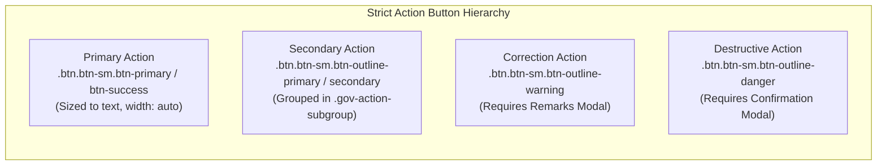

# UI_UX_DESIGN_GUARDRAILS.md
# Permanent UI/UX Design Consistency & Quality Gate
## Government of Sikkim Services Prototype Framework

---

## 1. OBJECTIVE & PURPOSE

This document establishes the permanent, non-negotiable **UI/UX Design Consistency and Quality Gate** for the centralized Sikkim Government Services Prototype Framework.

Approximately 30 Government-to-Citizen (G2C) web service prototypes are being developed in this repository. All services, stages, screens, and components must adhere strictly to **one unified design system, navigation structure, typography scale, layout convention, component library, and responsive behavior**.

This standard is designed to prevent **design drift**, regression, layout misalignment, horizontal overflow, button distortion, and unnecessary re-engineering during ongoing and future prototype implementations.

---

# PART 1 – APPROVED DESIGN SYSTEM & COMMON PLATFORM STANDARDS

## 1.1 APPROVED DESIGN SYSTEM TOKENS & CONVENTIONS

All prototype development must utilize the centralized design tokens and variables defined in `shared/css/themes.css` and `common/css/themes.css`. Never introduce ad-hoc hex colors, arbitrary inline dimensions, or conflicting font rules.

### A. Semantic Color Palette & Themes
The portal supports five official departmental theme palettes, configured via `data-theme="..."` on `<body>`:

| Theme Name | Attribute | Primary Color (`--gov-primary`) | Department / Service Context |
| :--- | :--- | :--- | :--- |
| **Forest & Revenue** | `data-theme="forest-green"` | `#114b3f` (Deep Pine Green) | Forest, Environment, Land Revenue, Tourism |
| **Default Slate** | `data-theme="default"` | `#0b4d75` (State Blue) | Administrative, General Citizen Services |
| **Tourism & Culture** | `data-theme="saffron-maroon"` | `#8a1428` (Heritage Maroon) | Cultural Affairs, Ecclesiastical, Heritage |
| **IT & Science** | `data-theme="royal-navy"` | `#1e3a8a` (Royal Navy) | Department of Information Technology, Science |
| **Urban Development** | `data-theme="teal"` | `#0f766e` (Mountain Teal) | Urban Development, Municipal Affairs |
| **High Contrast** | `data-theme="high-contrast"` | `#ffff00` on `#000000` | Accessibility mode (GIGW 3.0 / WCAG 2.1 AA) |

#### Standard Functional Status Tokens:
- **Success / Approved**: `--gov-success: #1b7a43;` | Light: `#e8f6ed;` | Border: `#a3d9b5;`
- **Warning / Review**: `--gov-warning: #b26a00;` | Light: `#fff8e6;` | Border: `#fcd580;`
- **Danger / Rejected**: `--gov-danger: #c5221f;` | Light: `#fdeeed;` | Border: `#f7a9a6;`
- **Info / Under Process**: `--gov-info: #0277bd;` | Light: `#e1f5fe;` | Border: `#81d4fa;`

### B. Typography Scale & Hierarchy
- **Font Families**: `'Noto Sans', -apple-system, BlinkMacSystemFont, 'Segoe UI', Roboto, sans-serif` for UI; `'Noto Serif'` for official certificates and declarations.
- **Hierarchy**:
  - `h1` (Main Portal Page Banner): `1.75rem` (28px), `fw-bold` (700)
  - `h2` (Section / Workspace Heading): `1.25rem` (20px), `fw-bold` (700)
  - `h3` (Card / Modal Header): `1.0rem` (16px), `fw-bold` (700)
  - `h4 / h5 / h6` (Sub-headings / Group Labels): `0.875rem` (14px), `fw-semibold` (600)
  - Body Text: `0.875rem` (14px), line-height `1.5`
  - Secondary / Meta Subtext: `0.75rem`–`0.8125rem` (12px–13px), `color: var(--gov-text-muted)`

### C. Geometry, Shadows, and Radii
- **Border Radius**:
  - Small elements (badges, small buttons): `var(--gov-radius-sm): 4px;`
  - Standard buttons, form controls: `var(--gov-radius-md): 6px;`
  - Cards, panels, modals: `var(--gov-radius-lg): 10px;`
  - Status pills: `var(--gov-radius-pill): 50rem;`
- **Elevation Shadows**:
  - Cards & Tables: `--gov-shadow-xs: 0 1px 2px rgba(0, 0, 0, 0.05);` or `--gov-shadow-sm: 0 1px 3px rgba(0, 0, 0, 0.1);`
  - Active Modals & Floating Desks: `--gov-shadow-md: 0 4px 6px -1px rgba(0, 0, 0, 0.1);`
  - Never use harsh, dark, or multi-layered custom shadows.

---

## 1.2 COMMON PAGE LAYOUT HIERARCHY

Every internal page (Citizen Dashboard, DTO Dashboard, HQ Dashboard, Application Form, Application Review, Reports, Tracking) must follow this exact 7-part vertical layout sequence:

```text
┌────────────────────────────────────────────────────────────────────────┐
│ 1. Government National / State Stripe (Tricolor / State Accent)        │
├────────────────────────────────────────────────────────────────────────┤
│ 2. Accessibility & Scenario Toolbar (Theme, Font A-, A, A+, Role Jump) │
├────────────────────────────────────────────────────────────────────────┤
│ 3. Government Branding Header (Emblem + Department Title + Officer ID) │
├────────────────────────────────────────────────────────────────────────┤
│ 4. Workspace Split Container                                           │
│    ┌───────────────────┬───────────────────────────────────────────┐   │
│    │ Sidebar Nav       │ 5. Main Page Heading & Primary Action Bar │   │
│    │ (260px Desktop)   │    (Clean Title + Role Badge + Action)    │   │
│    │                   ├───────────────────────────────────────────┤   │
│    │ - Active Tabs     │ 6. Action-Oriented Workload KPIs (Max 4)  │   │
│    │ - Queue Counts    ├───────────────────────────────────────────┤   │
│    │ - Office Info     │ 7. Main Content Area                      │   │
│    │                   │    - Dual View Work Queue (Table/Cards)   │   │
│    │                   │    - Review Split Workspace (Tabs/Desk)   │   │
│    └───────────────────┴───────────────────────────────────────────┘   │
├────────────────────────────────────────────────────────────────────────┤
│ 8. Mandatory GIGW Footer (NIC Copyright, Terms, Last Updated Date)     │
└────────────────────────────────────────────────────────────────────────┘
```

---

## 1.3 NAVIGATION CONSISTENCY RULES

1. **Header Positioning**:
   - Fixed or sticky-top only where required; height must remain consistent (`56px`–`64px`).
   - Left side: Official Sikkim Government emblem (height `48px`–`52px`) + State & Department name.
   - Right side: Active Officer/Citizen name + designation + role badge + Switch Role/Logout button.
2. **Sidebar Navigation & Menu Spacing Rules**:
   - Width: strictly `260px` on desktop ($\ge 992\text{px}$) with `flex-shrink: 0 !important; min-width: 260px !important; max-width: 260px !important;`.
   - Sidebar Container Padding: `px-2 py-3` (8px lateral, 16px vertical) ensuring balanced space from edges.
   - Non-Stacking Standard: Menu link text must **never** wrap or stack across multiple lines (`white-space: nowrap !important;` on `.officer-nav-link`, `.gov-sidebar-link`, and their inner `<span>`).
   - Sizing & Spacing: font size `0.8125rem` (13px), padding `0.42rem 0.65rem`, gap `0.5rem`, line-height `1.25`.
   - Icons: standard Bootstrap Icons, fixed width `1.25rem`, centered, flex-shrink 0.
   - Badges: `margin-left: auto !important; flex-shrink: 0 !important; font-size: 0.72rem; padding: 0.18rem 0.45rem; border-radius: 10rem; font-weight: 700;`.
   - Active State: background `var(--gov-sidebar-active)`, text `var(--gov-primary)`, bold indicator border on the left (`3px solid var(--gov-primary)`), with `border-top-left-radius: 0; border-bottom-left-radius: 0;` for a sharp, straight accent bar.
   - Mobile Behavior: Collapses into an off-canvas drawer or top toggle menu on viewports $< 992\text{px}`. Never allow the sidebar to permanently squeeze or push the main content off-screen.

3. **Zero Horizontal Scroll & Viewport Protection**:
   - `html, body` must enforce `overflow-x: hidden !important; width: 100% !important; max-width: 100vw !important;`.
   - Main content containers (`#main-dto-content`, `#main-hq-content`, `.gov-workspace-content`) must enforce `flex: 1 1 0% !important; min-width: 0 !important; max-width: 100% !important; overflow-x: hidden !important;`.
   - Data tables must be nested in `.table-responsive` with `overflow-x: auto;` inside the card; no page-level horizontal scrollbar or empty right-hand dead canvas is permitted at any viewport.

---

## 1.4 BUTTON & ACTION HIERARCHY (THE ANTI-SLAB STANDARD)



### Mandatory Button Rules:
1. **The Anti-Slab Rule**: Action buttons must **never** be stretched to $100\%$ width (`w-100` / `d-grid`) across cards, workflow action panels, or mobile containers.
2. **Standard Button Size**: All interactive buttons in tables, cards, toolbars, and action desks must use `.btn-sm` (`font-size: 0.8125rem; padding: 0.32rem 0.85rem; border-radius: 6px; width: auto !important; display: inline-flex !important;`).
3. **Table Action Cell Protection**: Table action cells must strictly use `<td class="text-end text-nowrap">`. Buttons inside table rows must be grouped horizontally in `.d-inline-flex.align-items-center.gap-1.5.text-nowrap`. Stacking buttons vertically inside table cells is strictly prohibited.
4. **Action Desk Alignment**: In officer review screens, the right-rail `#workflowActionsContainer` must use `display: flex !important; flex-direction: column !important; align-items: flex-start !important;`. Primary triggers remain full-opacity, while secondary buttons are enclosed in `.gov-action-subgroup`.

---

## 1.5 TABLE AND LIST DESIGN RULES

1. **Maximum Column Limit**: Tables must display between 5 and 6 essential columns. Long narrative fields (descriptions, full addresses) must be truncated (`.text-truncate`, max-width `240px`) or reserved for the detail review screen.
2. **Column Width Proportions**:
   - `Application ID`: `16%`–`18%` (monospace font, bold, primary link)
   - `Applicant & Contact`: `18%`–`22%`
   - `Category`: `12%`–`15%` (badge container)
   - `Submitted Date`: `12%`–`14%`
   - `Status & Stage`: `14%`–`16%` (accessible status pill)
   - `Action`: `14%`–`16%` (`text-end`, `text-nowrap`, min-width `160px`)
3. **Dual Responsive View**:
   - Desktop & Laptop ($\ge 768\text{px}$): `.gov-table-desktop` with `.table-hover` and compact padding.
   - Mobile ($< 768\text{px}$): `.gov-cards-mobile` containing `.gov-mobile-app-card`. Each card renders Application ID, applicant, stage pill, and a single right-aligned compact button. Horizontal scrolling of data tables on mobile is prohibited.

---

## 1.6 UX & CONTENT STANDARDS (PLAIN LANGUAGE DICTIONARY)

All prototypes must replace administrative jargon with plain, citizen-centric English:

| Prohibited Administrative Term | Mandatory Standard Term | Usage Context |
| :--- | :--- | :--- |
| *Scrutinize* / *Scrutinizing* | **Verify** / **Verifying** | DTO verification, document checks |
| *Scrutiny* | **Verification** | Queue names, desk titles, audit history |
| *Applicant Particulars* | **Applicant Details** | Form sections, summary tabs |
| *Statutory Sanction Authority* | **Approving Authority** | Designations, letter sign-offs |
| *Objection* | **Correction Required** / **Remarks** | Transmittal notes, return instructions |
| *Revert to Applicant* | **Return for Correction** | Workflow actions, citizen alerts |
| *Under Scrutiny* | **Under Review** | Status pills, tracking steps |
| *ARN* | **Application ID** | Public headers, citizen dashboard |
| *Process the case* | **Review Application** | Queue action buttons |
| *Disposition* / *Disposal Order* | **Verification Decision** | Officer action desk headings |

---

## 1.7 RESPONSIVE DESIGN & TEST VIEWPORTS

Every screen must be verified across five mandatory viewport targets:

| Device Category | Target Viewport | Mandatory Visual Expectations |
| :--- | :--- | :--- |
| **Desktop** | $1440 \times 900$ | Full 260px sidebar, multi-column dashboard, balanced white space, no empty gaps |
| **Laptop** | $1366 \times 768$ | Full sidebar, compact tables fit within viewport width, action buttons unclipped |
| **Tablet** | $768 \times 1024$ | Collapsible navigation drawer, simplified table columns, non-wrapping action cells |
| **Mobile** | $390 \times 844$ | Single column, mobile cards active (`.gov-cards-mobile`), minimum 44px touch targets |
| **Small Mobile** | $360 \times 800$ | Zero horizontal page overflow, clean vertical stacking, readable 14px body text |

---

## 1.8 GIGW 3.0 & ACCESSIBILITY REQUIREMENTS

1. **Semantic HTML**: Proper landmark elements (`<header role="banner">`, `<main>`, `<nav aria-label="...">`, `<aside>`, `<footer role="contentinfo">`).
2. **Keyboard Focus**: Focus visible indicator (`--gov-focus-ring: 0 0 0 3px rgba(255, 204, 0, 0.85);`) must appear on all interactive controls during tab navigation.
3. **No Color-Alone Status**: Every status badge must combine an icon + text label + high-contrast background (e.g. `<span class="gov-status-pill gov-status-pill-approved"><i class="bi bi-check-circle-fill me-1"></i>Approved</span>`).
4. **Skip Navigation**: High-priority skip-to-content link (`.gov-skip-link`) must be the first focusable element on every page.
5. **Form Labels**: Every `<input>`, `<select>`, and `<textarea>` must have an explicit matching `<label for="...">`.

---

# PART 2 – MANDATORY PRE-IMPLEMENTATION CHECK

Whenever a new implementation prompt is received, the agent must perform and document the following five pre-implementation checks **before** writing any code:

### Check 1 – Read Project Instructions
Inspect `PROTOTYPE_IMPLEMENTATION_WORKFLOW.md`, `UI_UX_DESIGN_GUARDRAILS.md`, and the target service configuration (`service-config.json`).

### Check 2 – Inspect Existing Master Templates
Examine the relevant files under `/templates/`:
- `public-portal-template.html`
- `citizen-dashboard-template.html`
- `officer-dashboard-template.html`
- `officer-review-template.html`
- `application-list-template.html`
- `application-form-template.html`
- `application-tracking-template.html`
Always use the approved master template as the starting structure. Never create an unverified layout from scratch.

### Check 3 – Inspect the Existing Implementation
Inspect existing HTML, CSS, JavaScript state engines, mock datasets, and active screen routes for the target service. Identify what already works and preserve it.

### Check 4 – Compare Against Approved Design
Check the page to be modified against the approved design tokens, header heights, sidebar width, button classes, and table structures. Note any existing deviations.

### Check 5 – Identify Potential Regressions
Assess whether the requested changes could accidentally impact shared stylesheets (`shared/css/`), common scripts, role-switching mechanisms, or previously approved screens.

---

# PART 3 – IMPLEMENTATION RULES (ZERO DESIGN DRIFT)

1. **Reuse Existing Components**: Use existing CSS classes (`.gov-kpi-card`, `.gov-table-compact`, `.gov-mobile-app-card`, `.gov-status-pill`, `.gov-workflow-panel`). Do not write redundant custom CSS for patterns that already exist.
2. **Scoped CSS Modifications**: If a service requires specialized styling, scope it strictly under the service container or service CSS file. Never overwrite global Bootstrap or `common/css/` selectors with breaking overrides.
3. **Preserve Prototype State & Functionality**:
   - Role switching (Citizen &harr; DTO &harr; HQ) must remain 100% operational.
   - District isolation rules (DTO sees only assigned district; HQ sees consolidated statewide data) must never be bypassed.
   - Dynamic mock data lifecycle (Draft &rarr; Submitted &rarr; Forwarded &rarr; Returned &rarr; Approved/Rejected) must remain fully interactive.
   - Document generators (QR codes, print layouts, PDF view modals) must remain linked to Application IDs.

---

# PART 4 – MANDATORY POST-IMPLEMENTATION QUALITY CHECK

After completing code changes, the agent must systematically evaluate the result against this 7-point checklist:

- [ ] **A. Layout Check**: Header, sidebar, and main workspace start at identical coordinates; margins and card paddings match standard scale; no horizontal overflow.
- [ ] **B. Navigation Check**: All role-relevant menu items visible; active tab indicated; drawer navigation functional on mobile.
- [ ] **C. Button & Action Check**: Primary action clear; secondary actions grouped; buttons sized to `.btn-sm` with `width: auto`; destructive actions have confirmation modals.
- [ ] **D. Table Check**: Columns limited to 5–6; action cell is `<td class="text-end text-nowrap">`; desktop table switches cleanly to mobile cards below 768px.
- [ ] **E. Responsive Check**: Verified at $1440\text{px}$, $1366\text{px}$, $768\text{px}$, $390\text{px}$, and $360\text{px}$.
- [ ] **F. Functional Regression Check**: Existing scenarios, status updates, resubmission workflows, and downloads continue working without console errors.
- [ ] **G. Visual Comparison**: Verified against master templates to ensure zero design drift.

---

# PART 5 – MANDATORY QUALITY GATE TABLE

Every completed implementation task must satisfy the following Quality Gate before submission:

| Quality Area | Required Standard | Status Threshold |
| :--- | :--- | :--- |
| **Common Header** | Consistent height, emblem, department title, officer badge, switch role | **MANDATORY PASS** |
| **Sidebar Navigation** | 260px desktop width, active tab styling, minimum 44px mobile touch targets | **MANDATORY PASS** |
| **Main Content Alignment**| Consistent padding (`1.5rem`–`2rem`), consistent page title placement | **MANDATORY PASS** |
| **Typography Scale** | Standardized `h1`–`h6` sizing, Noto Sans font, plain English terminology | **MANDATORY PASS** |
| **Button Hierarchy** | Compact `.btn-sm`, `width: auto !important`, anti-slab rule enforced | **MANDATORY PASS** |
| **Table Formatting** | 5–6 columns, action cell `text-nowrap`, zero horizontal page overflow | **MANDATORY PASS** |
| **Responsive Dual View** | Desktop table &rarr; mobile cards (`.gov-mobile-app-card`) on viewports $< 768\text{px}$ | **MANDATORY PASS** |
| **Desktop ($1440 \times 900$)** | Balanced 2-column layout, unclipped tables and cards | **MANDATORY PASS** |
| **Laptop ($1366 \times 768$)** | Table columns and action buttons fully visible without horizontal scroll | **MANDATORY PASS** |
| **Tablet ($768 \times 1024$)** | Responsive navigation drawer, well-aligned forms and metric cards | **MANDATORY PASS** |
| **Mobile ($390 \times 844$)** | Stacked single-column layout, touch-friendly action buttons | **MANDATORY PASS** |
| **Small Mobile ($360 \times 800$)**| Zero horizontal overflow, unclipped text, accessible forms | **MANDATORY PASS** |
| **GIGW / Accessibility** | High-contrast status pills, visible focus rings, labels on form fields | **MANDATORY PASS** |
| **Existing Functionality** | Role switching, workflows, mock state, document generation preserved | **MANDATORY PASS** |

---

# PART 6 – TASK REPORTING TEMPLATES

Every future implementation task response must include the following two structured reports:

### 1. Pre-Implementation Check Report (Emitted at start of task)
```markdown
### Pre-Implementation Design Consistency Check
- **Project instructions inspected**: Yes (`PROTOTYPE_IMPLEMENTATION_WORKFLOW.md` & `UI_UX_DESIGN_GUARDRAILS.md`)
- **Approved templates inspected**: Yes (list templates inspected)
- **Existing implementation inspected**: Yes (list files inspected)
- **Common design consistency**: Pass / Issues Identified
- **Responsive issues identified**: Yes / No
- **Potential regression risks**: (List any shared CSS/JS or workflow dependencies)
- **Planned files to modify**: (Explicit file list)
```

### 2. Post-Implementation Quality Check Report (Emitted upon completion)
```markdown
### UI/UX Quality Gate Verification Report
- **Common Header Alignment**: [Pass / Fail / Not Applicable]
- **Sidebar Navigation Alignment**: [Pass / Fail / Not Applicable]
- **Main Content Alignment**: [Pass / Fail / Not Applicable]
- **Button Sizing & Anti-Slab Standard**: [Pass / Fail / Not Applicable]
- **Table Responsiveness & Action Cell Nowrap**: [Pass / Fail / Not Applicable]
- **Desktop Layout ($1440 \times 900$)**: [Pass / Fail / Not Applicable]
- **Laptop Layout ($1366 \times 768$)**: [Pass / Fail / Not Applicable]
- **Tablet Layout ($768 \times 1024$)**: [Pass / Fail / Not Applicable]
- **Mobile Layout ($390 \times 844$)**: [Pass / Fail / Not Applicable]
- **Small Mobile Layout ($360 \times 800$)**: [Pass / Fail / Not Applicable]
- **Plain English Terminology Compliance**: [Pass / Fail / Not Applicable]
- **Existing Functionality Preserved**: [Pass / Fail / Not Applicable]
- **Visual Regression Status**: [None / Issues Found & Resolved]
- **Files Created**: (List)
- **Files Modified**: (List)
- **Components Reused / Updated**: (List)
```

---

# PART 7 – PERMANENT ENFORCEMENT ACROSS ALL 30 SERVICES

This design standard is permanently active and mandatory across all 30 Sikkim Government G2C prototypes. It applies universally to:
1. **Stage 01**: Service Landing Page (`index.html`)
2. **Stage 02**: Citizen Dashboard & Scenario Switcher (`dashboard.html`)
3. **Stage 03**: Multi-Step Application Form & Validation (`apply.html`)
4. **Stage 04**: Department Workflows, DTO & HQ Desks (`dashboard-dto.html`, `dashboard-hq.html`, `review.html`)
5. **Stage 05**: Payment Simulation, where applicable
6. **Stage 06**: Statutory Document Generation & Sanctions (`permission-letter.html`, `approval-sheet.html`)
7. **Stage 07**: Role-Based Reports & Statewide Analytics (`reports.html`)

No individual service may deviate from the common layout, button hierarchy, table structure, or responsive standards established herein.

